Отлично, Артём! Давай составим качественный `README.md` для твоего проекта. Я сделаю его структурированным, с пояснениями команд и готовым к публикации на GitHub/Gitflic.

Создай файл `README.md` в папке `my-mysql` и вставь туда следующий контент:

```markdown
# Интерактивная работа с MySQL в изолированном окружении Docker

## 📋 Описание

Учебный проект по работе с СУБД MySQL 8.0 в контейнере Docker.  
В ходе работы выполняются основные операции с базами данных: создание БД и таблиц, вставка/обновление/удаление данных, создание дампа, анализ логов.

**Цель работы:** освоить интерактивное взаимодействие с MySQL через Docker, научиться управлять контейнером и работать с логами СУБД.

---

## ⚙️ Требования

- Установленный [Docker](https://www.docker.com/)
- Терминал (Bash / Git Bash / PowerShell)
- Текстовый редактор (VS Code)

---

## 📁 Структура проекта

```
my-mysql/
├── README.md          # Документация проекта
├── my.cnf             # Конфигурация MySQL (UTF-8, general_log)
├── dump_clean.sql     # Дамп базы данных my_database
├── my_actions.log     # Отфильтрованный лог SQL-запросов
└── container_log.txt  # Лог контейнера Docker
```

---

## 🚀 Пошаговое выполнение

### Шаг 1. Запуск контейнера MySQL

**1.1. Создание конфигурационного файла `my.cnf`:**

```ini
[mysqld]
character-set-server = utf8mb4
collation-server = utf8mb4_unicode_ci
general_log = 1
general_log_file = /var/lib/mysql/general.log
log_output = FILE

[client]
default-character-set = utf8mb4

[mysql]
default-character-set = utf8mb4
```

**1.2. Запуск контейнера:**

```bash
docker run --name my-mysql \
  -e MYSQL_ROOT_PASSWORD=123 \
  -e LANG=C.UTF-8 \
  -v mysql_data:/var/lib/mysql \
  -v $(pwd)/my.cnf:/etc/mysql/conf.d/my.cnf \
  -d mysql:8.0
```

**Параметры команды:**
| Флаг | Описание |
|------|----------|
| `--name my-mysql` | Имя контейнера |
| `-e MYSQL_ROOT_PASSWORD=123` | Пароль root-пользователя |
| `-e LANG=C.UTF-8` | Локаль UTF-8 для корректной работы с кириллицей |
| `-v mysql_data:/var/lib/mysql` | Именованный volume для данных БД |
| `-v $(pwd)/my.cnf:...` | Монтирование конфигурации |
| `-d` | Запуск в фоновом режиме |
| `mysql:8.0` | LTS-версия официального образа |

**1.3. Проверка запуска:**
```bash
docker ps
```

---

### Шаг 2. Подключение к MySQL

```bash
docker exec -it my-mysql mysql --default-character-set=utf8mb4 -uroot -p
```
Пароль: `123`

---

### Шаг 3. Работа с базами данных

**Создание БД и таблицы:**
```sql
CREATE DATABASE my_database CHARACTER SET utf8mb4 COLLATE utf8mb4_unicode_ci;
USE my_database;

CREATE TABLE users (
    id INT AUTO_INCREMENT PRIMARY KEY,
    name VARCHAR(100) NOT NULL,
    email VARCHAR(100) NOT NULL UNIQUE
) CHARACTER SET utf8mb4 COLLATE utf8mb4_unicode_ci;

INSERT INTO users (name, email) VALUES
  ('Иван Иванов', 'ivan@example.com'),
  ('Пётр Петров', 'petr@example.com'),
  ('Мария Сидорова', 'maria@example.com');
```

**Вставка дополнительных данных:**
```sql
INSERT INTO users (name, email) VALUES ('Павел Иванов', 'pavel@example.com');
INSERT INTO users (name, email) VALUES ('Марк Аврелий', 'mark@example.com');
```

**Обновление записи:**
```sql
UPDATE users SET name = 'Иван Петров' WHERE id = 1;
```

**Выборка данных:**
```sql
SELECT * FROM users;
SELECT name, email FROM users WHERE id = 1;
SELECT * FROM users WHERE id = 1\G   -- вертикальный вывод
```

---

### Шаг 4. Создание дампа базы данных

Выход из MySQL:
```sql
\q
```

Создание дампа:
```bash
docker exec -e MYSQL_PWD=123 my-mysql mysqldump -uroot \
  --set-gtid-purged=OFF \
  --single-transaction \
  my_database > dump_clean.sql
```

---

### Шаг 5. Работа с логами

**Включение general_log (если выключен):**
```bash
docker exec -it my-mysql mysql --default-character-set=utf8mb4 -uroot -p \
  -e "SET GLOBAL general_log = 'ON'; SET GLOBAL general_log_file = '/var/lib/mysql/general.log';"
```

**Просмотр лога:**
```bash
MSYS_NO_PATHCONV=1 docker exec my-mysql cat /var/lib/mysql/general.log
```

**Фильтрация и сохранение только SQL-запросов:**
```bash
MSYS_NO_PATHCONV=1 docker exec my-mysql cat /var/lib/mysql/general.log \
  | grep "Query" \
  | grep -v -E "SET NAMES|SET autocommit|SET sql_mode|SET character_set_results|SHOW VARIABLES|SHOW STATUS|SHOW WARNINGS|SELECT @@|SELECT DATABASE\(\)|time_zone" \
  > my_actions.log
```

**Очистка лога:**
```bash
MSYS_NO_PATHCONV=1 docker exec my-mysql sh -c ': > /var/lib/mysql/general.log'
```

> ⚠️ **Примечание для Windows (Git Bash):** префикс `MSYS_NO_PATHCONV=1` необходим, чтобы Bash не конвертировал пути `/var/lib/...` в локальные `D:/Git/var/lib/...`.

---

### Шаг 6. Управление контейнером

```bash
docker stop my-mysql      # Остановка
docker start my-mysql     # Запуск
docker logs my-mysql      # Просмотр логов
docker logs my-mysql > container_log.txt  # Сохранение логов
```

---

## 🧹 Очистка после работы

```bash
docker stop my-mysql
docker rm my-mysql
docker volume rm mysql_data
```

---

## 📚 Полезные команды

| Команда | Описание |
|---------|----------|
| `docker ps -a` | Список всех контейнеров |
| `docker exec -it <имя> bash` | Вход в контейнер |
| `SHOW DATABASES;` | Список баз данных |
| `SHOW TABLES;` | Список таблиц |
| `\q` | Выход из MySQL |
| `help` | Справка по командам клиента |

---

## 📝 Результаты работы

В ходе выполнения лабораторной работы были получены следующие артефакты:
- `dump_clean.sql` — резервная копия БД `my_database`
- `my_actions.log` — отфильтрованный журнал SQL-запросов
- `container_log.txt` — системный лог контейнера

---

## 👤 Автор

**Котохин Артём Ильич**  
Специальность 09.02.07 «Информационные системы и программирование»  
2 курс, 2026 г.
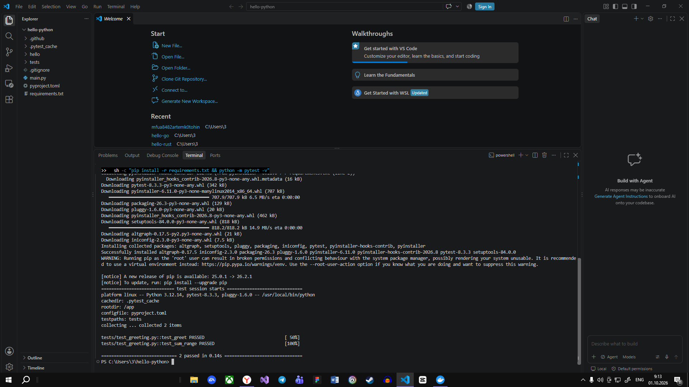
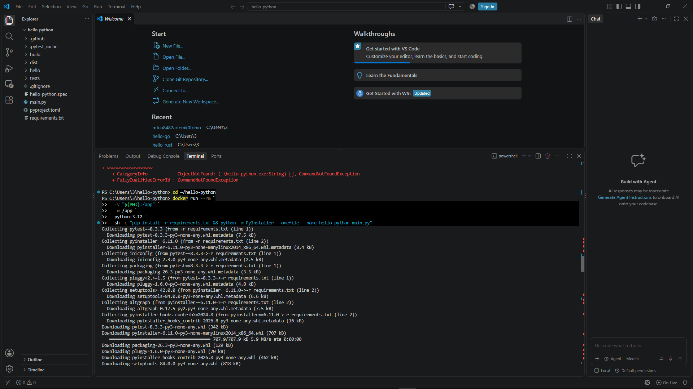
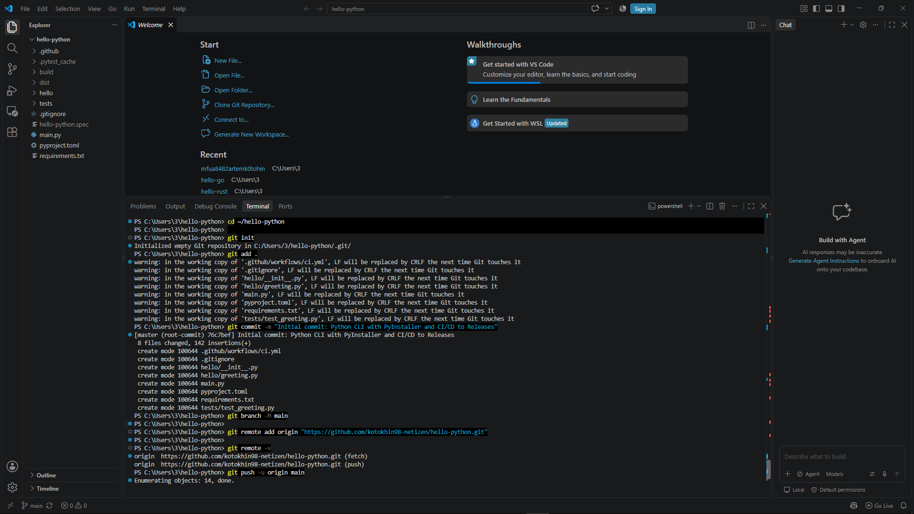
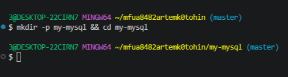
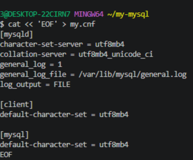
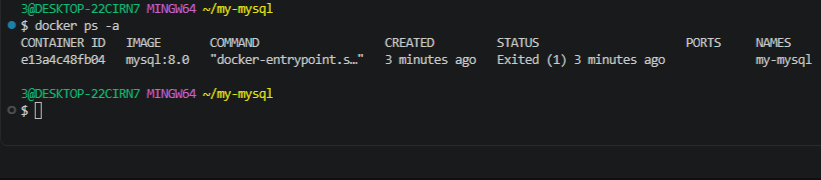
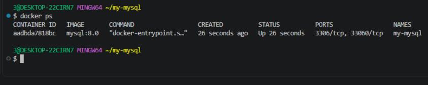
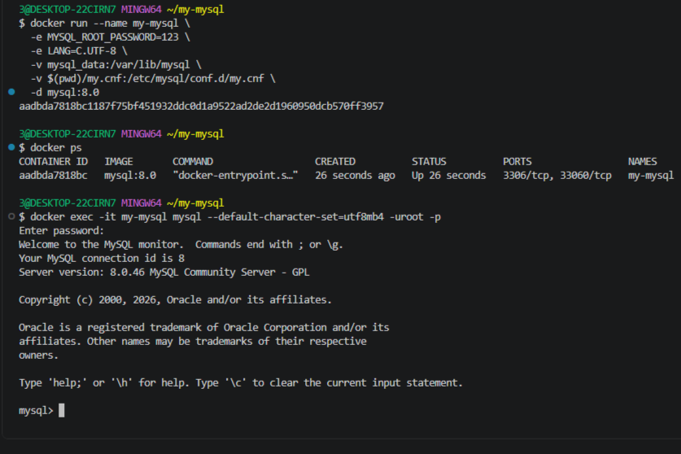
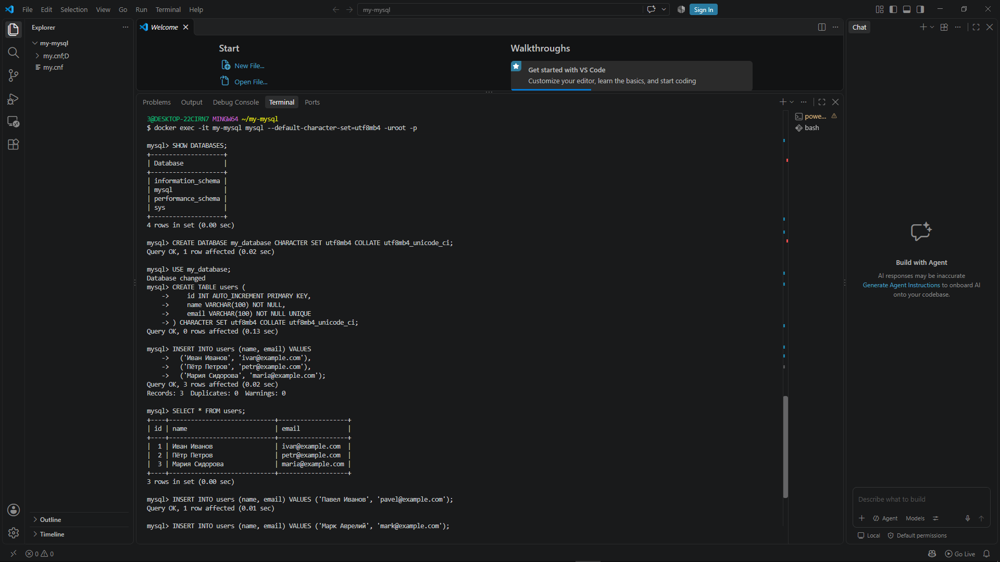
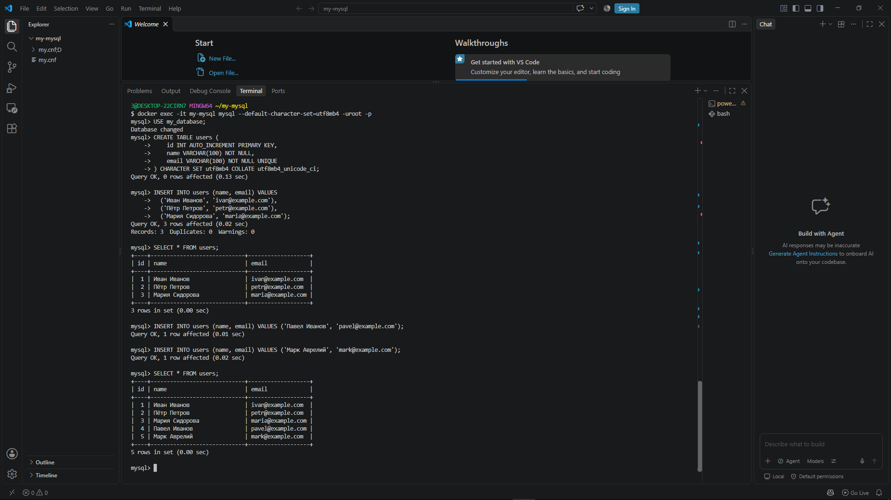
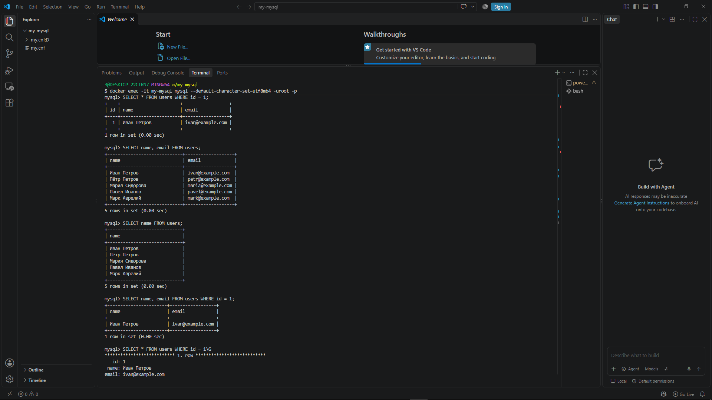
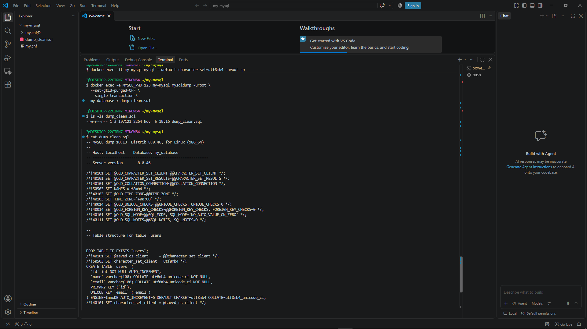
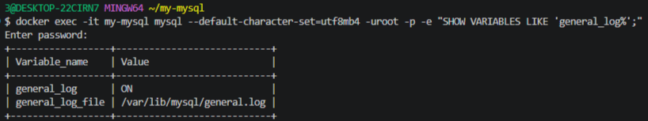
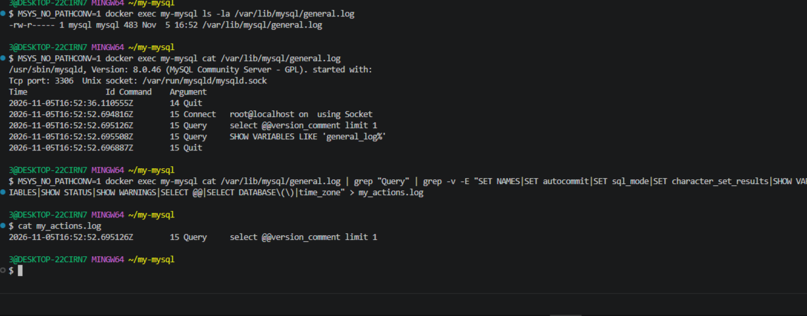